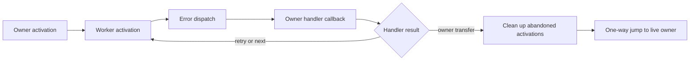

<!--
Project: FreeBASIC C backend
File: c-error-frame-lowering.md
Purpose: Define the next implementation boundary for cross-procedure errors.
Responsibilities: Preserve the failing reproducer, describe proven ownership
    rules, and identify compiler/runtime changes still required.
This file intentionally does NOT claim that the emitter defect is repaired.
-->

# C error-frame lowering

The current emitter still transfers raw label addresses between C functions.
The v29 compiler reproduces the complete v27 C bytes for both global and LOCAL
variants of `build/c-emitter-audit-20261022/cross-procedure-error.bas`.
Its retained Clang global O0/O2 executions both access-violate with 3221225477;
GCC global and all four LOCAL controls return zero. Those GCC passes do not
establish a valid C transfer contract. No warning or native gate was repeated
to establish these four exact-C counterparts.

The reproducer keeps a 32-element automatic array in the module entry and
another in its worker. The module installs its handler, the worker raises
`ERROR 24`, and the handler checks the module array before `RESUME NEXT`.
The worker must then set its completion flag and return normally. This is the
minimal next compiler gate; source and receipts are preserved under
`error-frame-current-v29-counterparts/`.

## Ownership established by the prototype

`error-frame-protocol.c` in the audit working directory demonstrates a synchronous
owner callback. The callback reads/writes owner storage while the worker remains
active, then returns a retry/next action. The worker resumes only its own code.
A transfer to ordinary owner code is a separate, one-way operation: clean up the
worker while its frame is alive, then jump to the live owner's `setjmp` anchor.
There is no subsequent attempt to resume that abandoned worker.



The first prototype exposed GCC's `-Wclobbered` warning for an automatic result
variable. The corrected version keeps all modified owner state in allocated
storage. Its registration also checks an activation generation and is retired
before owner storage is released. Generation checks supplement lifetime rules;
they do not make a dangling owner pointer safe.

The corrected prototype passes eight Windows target objects/four native runs
and four Linux ELF objects/four native runs. Every run checks global resume-next,
global retry, owner exit with cleanup, and local handling. All twelve object
checks retain the full supported warning profiles and report zero warnings.
The Linux transfer is a 5,538-byte C/helper bundle. Installed compilers and
runtime libraries are unchanged. These are standalone protocol controls,
separate from both the v29 type-name qualification and the older v18 termination
checks on Midcom, FreeBSD, Haiku and ARMhf.

## Production runtime bridge

`src/rtlib/errors/error_frame.c` and `fb_error_frame.h` now implement the runtime
part of this protocol. `FB_ERRORCTX` and its legacy handler type retain their
size and layout. A separate ERRORFRAME TLS key follows all eight existing keys.
The runtime TLS implementation must be rebuilt with that enlarged key table;
mixing the new bridge with an old `thread_ctx.o` is unsupported. Existing error
getters and other archive members were deliberately retained in qualification.

An activation enters before registration and leaves before its storage expires.
`fb_ErrorFrameBuffer()` allocates the owner's actual `jmp_buf` before the caller
establishes its checkpoint. `fb_ErrorFrameReady()` records that checkpoint;
`fb_ErrorFrameSetHandler()` returns a status separately from the previous
handler. A null previous handler is a successful result, not an allocation error.
The callback has type `int (*)(void *)`; it returns RETRY, NEXT, TRANSFER or
UNHANDLED. On TRANSFER it first selects a positive owner target with
`fb_ErrorFrameSetTarget()`. Modified owner data must reside outside automatic
storage that becomes indeterminate after `longjmp`.

Legacy setters may save and restore an opaque registered callback token. The
bridge recognizes only its live registry entries, without reading arbitrary
legacy label addresses. It invokes the real callback and returns the failing
activation's continuation. It never returns a metadata address as executable
code. Repeating registration reuses the existing callback record.

Nested callbacks and legacy LOCAL throws preserve the outer error state.
Reentry of an active callback aborts. One-way transfer retires child metadata
before calling cleanup, since cleanup may free the storage containing that
frame. Cleanup may call ordinary functions with balanced activation entry/exit;
it cannot register another owner checkpoint or remove the unwind boundary.
Normal leave does not call cleanup, because the normal compiler exit path owns
that destruction. TLS teardown frees metadata without touching expired frames.
The cleanup walk covers registered activations. It cannot discover resources in
old BASIC objects that have no frame registration; compiler qualification must
include the rebuilt callers and libraries whose destruction it promises.

On Windows x86_64, native `longjmp` also needs the machine unwind records for
`errors/error.c` and `errors/error_frame.c`. The runtime's default C flags
disable those records. The Make rules now retain `-funwind-tables` for these
two objects in the ordinary, PIC, threaded and threaded-PIC archives, including
builds that supply `ALLCFLAGS` on the command line. The runtime configuration
fingerprint includes this requirement so existing objects are rebuilt.
This is the same platform requirement already applied to `core/gosub.c`.
BASIC resource destruction and native frame unwinding are separate steps.

The v61 private worker-transfer control originally failed with native exit
3221225727. Adding the missing runtime unwind records makes the exact same
emitted C and worker object pass, without changing the checkpoint ABI.
The rebuilt objects retain the same external definitions and dependencies.
The 31 focused native passes cover the original GOSUB failure, resumable
handlers, owner cleanup and worker abandonment. They do not qualify the whole
compiler/runtime graph, general resource unwinding, other platforms or the
requested warning-free suite matrix. The v61 compiler changes remain private.

The v62 private follow-up enters the cleanup frame at procedure entry and
establishes its resume checkpoint at the first handler selection. This closes
the scalar-string/heap-storage lifetime gap before ON ERROR executes. Both C
producers emit identical C for the new fixture; GCC and Clang at O0/O2 pass its
twelve early-error/local-resume executions. The earlier eight return/recursion
checks now use an observer that checks every frame's balanced entry/leave while
retaining the original BASIC checkpoint-retirement counts. The old observer's
exit 71 is preserved: identical-source/runtime comparison isolates its rejected
`frame->owner == NULL` state, rather than missing string destruction. The new
observer rejects the old v61 registration gap with exit 73 and accepts v62.
This is a private ownership repair; general transfers, other resource kinds and
the full compiler/runtime/platform warning gate remain unfinished.

Legacy throw/resume hooks read optional state through `fb_TlsGetCtxExisting()`.
Only activation entry creates the ERRORFRAME context. This avoids introducing
allocation into the existing legacy signal/error path. The fixture proves that
legacy throw/resume leaves this context absent and checks both invalid key
boundaries. The pre-fix bridge fails that control with exit 33.

The v37 Windows matrix compiled 64 real COFF objects, including Win32 objects,
and executed 48 fresh standard/threaded/allocation cases. Native Linux compiled
forty ELF objects and executed forty cases with
GCC 15.2 and Clang 21.1.8. A further twelve Linux objects and three executions
pass AddressSanitizer, UndefinedBehaviorSanitizer and leak detection across
standard, threaded and allocation configurations. Each positive execution
exercises nested owners, retry/next, legacy restore and heap-owned cleanup.
Fatal controls retain expected exits 3, 3 and 5.

Two further current-source checks run GCC's analyzer and Clang's core, unix and
deadcode path checks on the bridge. Both accept it with zero bridge/header
diagnostics; their complete compiler warning logs are retained separately in
`production-error-frame-path-analysis-v37/`.

The new bridge, header and fixture produce zero warnings under the full warning
profiles. Other runtime/header warnings remain in the complete logs. The new
TLS read reuses the same lookup in `fb_TlsGetCtx()` instead of duplicating the
indexed read; its warning-family counts remain equal to v34. The intermediate
v36 extra Clang buffer warning is retained in its receipts, without suppression.
These changes do not add compiler lowering.
The maintained Windows runner is `build_scripts/test-error-frame-runtime.py`:

```powershell
python build_scripts/test-error-frame-runtime.py `
  --gcc C:/freebasic-js/toolchain/ucrt64/bin/gcc.exe `
  --clang C:/freebasic-js/toolchain/ucrt64/bin/clang.exe `
  --runtime-dir lib/win64 --output build/error-frame-runtime
```

It retains full diagnostics and pins source, headers, tools and runtime inputs.
`--configuration`, `--backend` and `--optimization` select bounded subsets;
`--resume` accepts only identical inputs and the identical selection. Win32 is
an object check here; no Win32 native execution is claimed. The installed
compiler/runtime archives have not been replaced. Other native platforms and
the complete runtime build remain further qualification work.

## Typed compiler binding checkpoint

The compiler now declares all eight frame entry points with their real argument
and result types. The entry points use FBCALL; their nested handler/cleanup
function pointers use CDECL. The registration metadata has an explicit option
for this difference. Existing ThreadCreate callbacks retain FBCALL. Existing
intrinsic indices keep their values; the eight new entries are appended.

`tests/rtlib/error-frame-bindings.bas` registers a callable handler explicitly,
then raises actual BASIC `ERROR 24` statements in a worker. It checks owner and
worker arrays, retry/next, restoration, all eight entry-point signatures and
invalid checkpoint/target operations. The maintained runner
`build_scripts/test-error-frame-bindings.py` passes four emissions, sixteen
BASIC COFF objects and eight native runs. Three runtime objects are built once
for those links. Win32 remains object-only coverage. A separate Win32 probe
produces the normal pointer-type warning for an incompatible stdcall handler;
four legacy ThreadCreate objects retain the accepted FBCALL signature.

The private candidate is `candidate-v38-bindings/fbc.exe`, SHA256
`a018ccc05f0a192acf32ad53ccd97a4bfe6ee888e31bec120b022d5090a662fc`.
It replaces two modules in the pinned v29 object family and reuses 187 objects.
It does not incorporate newer concurrent semantic-tooling work. An attempted
current-source combination exposed missing numeric-conversion dependencies;
that failed link and its inputs remain separate. No installed tool was changed.
`source-epoch-error-frame-v39.json` records the current three-file compiler epoch.
The v38 epoch remains preserved for the integration snapshot. The only later
compiler edit fills fifteen omitted zero-valued initializer fields explicitly;
its rebuilt object is byte-identical, so the existing candidate/native results
remain valid. The new initializer warnings are removed without a relink.

The original BASIC ON ERROR regression was freshly emitted, compiled and run
against this candidate and the new runtime bridge. Its two Clang global runs
still access-violate; both GCC global runs and all four LOCAL controls pass.
`original-global-error-v38/results.json` is the direct negative result. The
manually registered callback test does not repair automatic handler lowering.

Both changed compiler modules pass eight current optimized GCC/Clang checks,
four of which reuse the unchanged rtl.bas qualification. Their scoped warning
delta retains one added alignment and qualifier warning per C compiler, fifteen
Clang identifier warnings and one Clang buffer warning. These remain emitter
work, rather than being suppressed. Strict non-semantic lint reports zero
findings in the three compiler files. Its PRINT advice in the BASIC fixture is
retained because that single success marker is an asserted runtime receipt.

The next compiler step is a capture-aware handler clone. A simple variable
substitution is insufficient: `astLoadIDX()` expects a VAR symbol with array
dimensions, origin and offset metadata. CALL result temporaries, scoped
declarations, labels and implicit destruction also retain symbol identities.
The clone must map those identities into the owner's live storage while
preserving initialization points and source observations. Shared handler/normal
code cannot be treated as a textual tail. Ordinary owner exits and GOSUB returns
also need an explicit transfer/lifetime decision before an activation is lost.

## Private capture outliner, v40 and v41

`capture-outliner-v40/sealed/fbc.exe` is a private compiler experiment, SHA256
`0273cd5294f868698f8f3ce2f3eb921e81901627e0d24e817aa938b18e2f41f8`.
It retains the v29 object family and the two v38 binding modules, replacing
the C backend and procedure AST modules. It is not a current-source semantic
compiler. Canonical compiler sources and installed tools remain unchanged.

The eligible owner is a module procedure already proven not to return, without
GOSUB. The handler graph must end in retry, next, or a proven non-returning call.
The prototype follows direct branches, preserves the original variable symbols
and array metadata, and maps their C references to typed pointers into live
owner storage. It hoists declarations without moving source initializers.
The helper returns an action to the failing activation; it does not jump into
the owner. The implementation records the original AST once before codegen roots
change; source-sidecar equivalence still needs qualification. Per-translation-unit
private state is reset for multi-source commands.

The unchanged original BASIC program now passes all eight Win64 native checks:
GCC and Clang, global and LOCAL controls, at O0 and O2. An additional eight
native checks exercise two retries followed by next, BYREF writes, VARPTR
identity, an independent worker array, and END from both normal execution and
inside the callback. A test-only linker wrapper observes real runtime teardown:
error-frame TLS exists before `fb_TlsFreeCtxTb()` and is absent afterward.
This proves metadata retirement for the eligible END paths. It does not qualify
ordinary returning owners or their source-object destruction.

Those sixteen native runs use the preceding private build. The sealed compiler
emits eight byte-identical C counterparts after allocation/state hardening;
the native checks were not repeated. Four additional C objects pass for two
source units emitted by each backend in one invocation. Returning-owner and
enabled-GOSUB controls retain byte-identical legacy C under both backends.
They are C-only fallback controls and are not successful native qualifications.
The first GOSUB fixture omitted OPTION GOSUB; its failed BASIC attempts and
partial C are explicitly excluded from the accepted-control count.

The v41 follow-up stages each helper's executable body below its temporary
declarations, without moving calls or assignments. Its private candidate is
`capture-outliner-v41/sealed/fbc.exe`, SHA256
`85d8644435c69f2f7bee68ddb598e39a4824ecbc5750cbc18277f0286ff4230e`.
Only the C backend was rebuilt; the qualified v40 AST object was retained.
All sixteen native checks pass freshly, including the eight teardown markers.
Four fresh multi-source C objects and four exact legacy fallback controls pass.

Warnings remain visible. For the unchanged original, each backend removes two
GNU label-extension diagnostics. Clang also removes one unreachable-code
diagnostic and five dollar-identifier diagnostics. V41 removes the added helper
declaration-order diagnostic; no warning family or count increases against the
v38 control in these eight C checks. Alignment, sign conversion, existing
declaration order, identifier and buffer diagnostics remain. No warning-free
claim is made.

The experiment rejects call result/argument data that its clone cannot own,
assembler and jump-table graphs, unsupported indirect transfers and LOAD exits.
Other owner procedures, ordinary returns, owner transfers and GOSUB remain
unimplemented. Managed captures and nested handler changes need further
qualification. Their fallback retains the original defect. The prototype has
not been applied to canonical compiler sources or installed runtime archives.
The overall cleanup and the general global-handler repair remain open.

Evidence is pinned in `checkpoint-error-frame-outliner-v41.json`, with original
negative controls retained in `original-global-error-v38/results.json`.

## Ordinary and recursive owners, private v42

The v42 candidate is `capture-outliner-v42/sealed/fbc.exe`, SHA256
`5555705729c80b1a3a4818d0a122e6e5e4ab3048f699227cb5acb0cddfae1bd5`.
It extends registration discovery to LOCAL setters inside assignments and
outlines ordinary procedures. Captured BYREF and BYDESC parameters retain their
physical pointer types. Normal function returns retire an active frame after
source cleanup; void procedures do the same before their C body closes. Exits
before registration leave the frame inactive. Existing LOCAL restoration runs
before retirement. This does not implement an exit from a handler into its owner.

Handler clones now form lists of the needed statements, instead of one sparse
pointer array per handler. Clone bookkeeping follows the existing TYPEINI and
bitfield ownership rules, and unused expression results are cleared between
helpers before vreg numbering restarts.

All eight original global/LOCAL native checks pass. Four additional native
checks cover ordinary function exits, BYREF pointer identity, BYDESC array
writes, captured string reads, and restoration of the outer handler. Four more
cover four recursive live activations. The test observer confirms string
destruction precedes frame retirement and that the runtime clears each retired
frame's owner pointer. Both C compilers pass at O0 and O2. These sixteen runs
are saved; they need not be repeated to restate the result. Strict lint of the
three private compiler files and two BASIC fixtures reports zero findings.

Twelve semantic models validate, but zero of the six before/after pairs are
byte-identical. The bounded comparison resolves internal symbol identities and
checks all AST graphs, node payloads, observed procedure phases and source
signatures. Those match. Added callback procedures are explicitly marked
compiler-owned and add no source procedure observations. The only changed
source symbol fact is the owner's label losing `FB_SYMBSTATS_ACCESSED`, the
native liveness bit, after its registration is replaced. No model repair is
needed for these subjects. Enabling model output also preserves native C
byte-for-byte in all six comparisons. This remains a cached-family comparison,
not qualification of the concurrent current-source semantic compiler.

`capture-outliner-v42/integration-plan/plan.json` selects the current 189-module
Make graph and pins the two private overlays. The next integration must compile
every current module with current shared includes, retaining no cached compiler
objects, then build and test a matching private Win64 runtime. The earlier v38
mixed-family link omitted numeric-conversion definitions from the current
semantic-expressions module. That is a lineage problem, not an external blocker.
The v42 checkpoint stopped before that integration. No canonical outliner or
installed archive was changed. Its source-graph comparison remains preserved
separately from the newer source epoch below. The original Clang failure remains
preserved in the v38 negative control.

## Current-source integration checkpoint v43

`checkpoint-current-source-integration-v43.json` seals one fresh Win64 compiler
and matching standard runtime. Its Make-selected graph contains 189 compiler
modules and 520 runtime sources, plus three runtime startup objects. The private
snapshot pins 1,443 files, including the physical compiler include closure,
current Make configuration and helper inputs. The three assertion-observer
source changes were already present at capture. No cached compiler objects or
old runtime object overrides were retained. The HLC and AST overlays remain
private; the canonical outliner has not been adopted.

All 189 compiler modules passed the aggressive unsuppressed GCC O2 pass and
all 189 passed the matching Clang O2 pass. The current-source link includes the
numeric-conversion definitions missing from the earlier mixed-object attempt.
The sixteen original, ordinary-owner and recursive-owner native checks passed
against the complete new runtime archive. All eight native C variants match the
sealed v42 C. Six current source-model packets validate and preserve their six
native C counterparts. Strict non-semantic lint reports four files, zero errors
and zero warnings. These packet checks do not claim whole-model equivalence
between different compiler source epochs.

The runtime source objects all compiled, but Make archive publication failed
because its shell consumed the backslashes in the archiver path. Correcting the
path spelling changed the Make configuration stamp and would have repeated 520
successful compilations. Native ar/ranlib instead published exactly those 520
pinned objects through a response file. The original failure, dry run, archive
member list and successful publication are retained separately. A passing Make
publication workflow is not claimed.

The compiler graph still reports 43,368 GCC warnings and 500,325 Clang warnings.
These are current compiler-source counts, not full-corpus results or an
improvement comparison against another source epoch. The overall goal remains
active. One-way owner transfers, GOSUB, unsupported handler graphs, broader
managed lifetimes, optimized assembly labels, the array-origin contract,
remaining warning families and affected corpus/project qualification remain
open. No installation or other-platform qualification was performed.

## Assembly-only source adoption v44

`checkpoint-asm-regions-v44.json` records the subsequent six-file canonical
assembly repair. It groups Intel C assembly regions, keeps BASIC-label jumps
separate from preceding writes, deduplicates operands, and gives contained
non-keyword labels an instance suffix. The error-owner outliner remains private.
The canonical AST procedure error hook is unchanged. The v43 source and runtime
receipts remain historical evidence; their old HLC preimage is no longer the
current emitter. Rebase the owned outliner changes onto v44 instead of copying
an older whole HLC file. No compiler or runtime archive was installed.

## Required compiler implementation and owners

| Component | Required responsibility |
| --- | --- |
| Parser `parser-quirk-on.bas`, `parser-quirk-goto-return.bas` | Keep existing label binding and accepted source syntax. Record registration/RESUME identity for lowering; do not reject programs to avoid the defect. |
| AST procedure/error lowering | Outline handler control flow into a callable helper. Give captured owner variables one stable storage identity, preserve initialization points and lexical cleanup, and represent RESUME as a helper result. Handler labels can share reachable code with normal execution, so textual extraction is insufficient. |
| `runtime/rtl-error.bas` | Typed frame bindings are present. Automatic registration/RESUME lowering must still keep failing continuations distinct from the owner entry. A resumed indirect branch must target its own C function. Preserve first-activation LOCAL save/restore. |
| `backend/c/ir-hlc.bas` | Emit the owner storage/callback and a live owner checkpoint for one-way transfers. Captured parameters, arrays, strings, UDTs, varargs, debug data and source sidecars must retain their contracts. Compiler-generated helpers must not duplicate source observations. |
| `fb_error_frame.h`, `errors/error_frame.c`, `errors/error.c` | Runtime bridge implemented and fragment-qualified as above. Compiler lowering must obey its lifetime/checkpoint contracts and rebuild the runtime TLS implementation. Preserve `fb_error.h` unchanged. |

The cached manual still says that LOCAL is ignored; the current compiler already
implements LOCAL activation/save/restore. Use the preserved implementation and
its regression receipts as authoritative. The main-module global reproducer
also satisfies the manual's documented global-handler placement.

The compiler patch must use the defined mixed-backend setter/throw/restore
bridge. Existing object files may call the old `fb_ErrorSetHandler` and
`fb_ErrorThrowEx` interfaces. Returning a callback descriptor where an old
caller expects a jump destination remains invalid.

Keep `FB_ERRORCTX` at its existing size and put the callback metadata in a
separate TLS context. `threads/thread_ctx.c` allocates a context only on first
access and does not resize it when a later caller requests a different length.
An older object can therefore allocate the old ERROR context before a new
helper runs; appending frame fields would then overrun that allocation.
Append any new TLS key after existing keys in `fb_thread.h`, retaining their
values, and qualify the platform implementations that size arrays by
`FB_TLSKEYS`. The new context destructor must release metadata without jumping
into an expired owner or invoking callbacks after their activations disappear.

The runtime fixture covers nested owners, nested legacy LOCAL overrides, errors
while handling an error, owner retirement, repeated registration and cleanup.
The private compiler-generated ordinary/recursive cases above are qualified;
other lifetime and control-flow cases still require qualification.
Capture storage must also handle variables
declared after registration, BYREF/VARPTR identity, arrays and variadic argument
lists. The prototype's single-owner cleanup walk is not a production unwinder.

## Source handoff

`error-frame-owner-handoff-v39.json` records current source pins and the owned
runtime/compiler-binding changes. The original v31 preimages remain preserved separately.
Recheck the current pins immediately before editing. If the
integration producer has changed a source, rebase the owned fragment onto that
source; never replace the file with the old snapshot. Production runtime/header
and three compiler runtime-interface files have changed. The emitter and inline
assembly parser now include the separate v44 repair. The canonical emitter also
includes the v45 C identifier repair described in `c-emitter-identifiers.md`,
the v46 constant dispatch repair in `c-emitter-dispatch.md`, v47 defined
source paths in `c-emitter-defined-paths.md`, v48 typed member access in
`c-emitter-members.md`, and v49 pointer/copy-source changes in
`c-emitter-pointers.md`, followed by v52 typed fixed-array indexing and its
separate dynamic-address expression in the same report. Error-specific parser and
AST procedure lowering remain at their preserved preimages.
No competing compiler or runtime has been installed.

The temporary-name investigation retains its successful unchanged-source v30
rebuild control. The later v45 repair now separates C tokens from original symbol
and object identities, with zero dollar-token warnings on the current compiler
graph. Outliner integration must use that C spelling interface at C expression
sites while retaining raw names in ABI/model contexts. Rebase its owned fragments
onto v55, including the qualified unaligned scalar/record transfers and pointer
qualifiers, while preserving the accepted current lexer endpoint repair;
the private v43 outliner candidate predates these canonical repairs.
Error-frame ownership and the remaining assembly/array defects remain required.

The overall C emitter cleanup remains unfinished. The private module-owner proof
does not complete canonical AST outlining, general captured-storage lifetime,
normal/abrupt cleanup lowering or broader compiler qualification. Those remain
required before the global-handler defect can be called repaired.

<!-- end of c-error-frame-lowering.md -->
